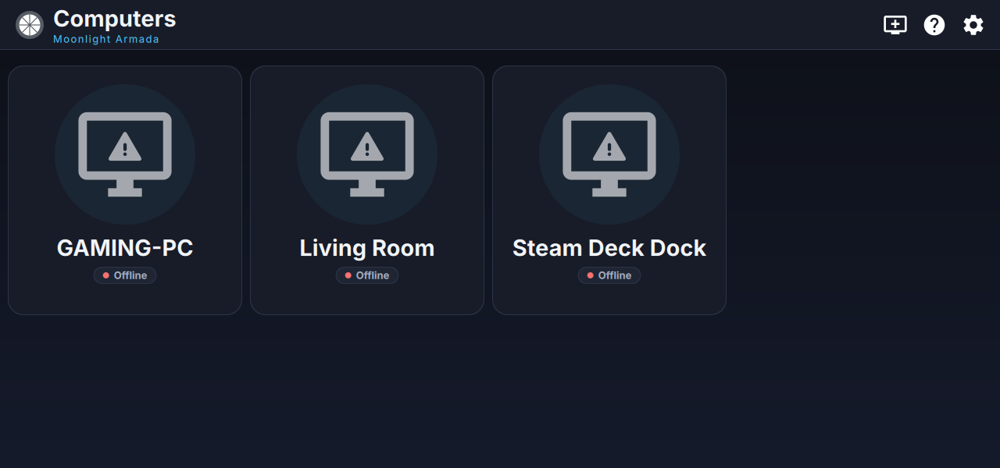
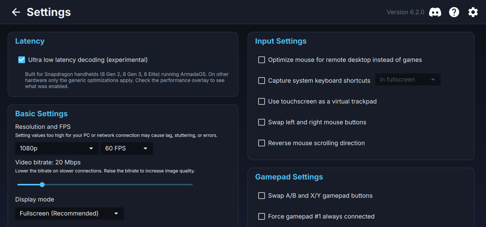
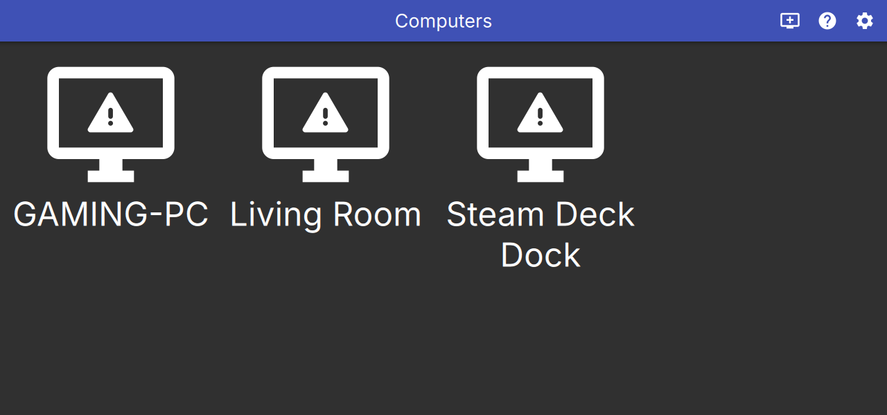
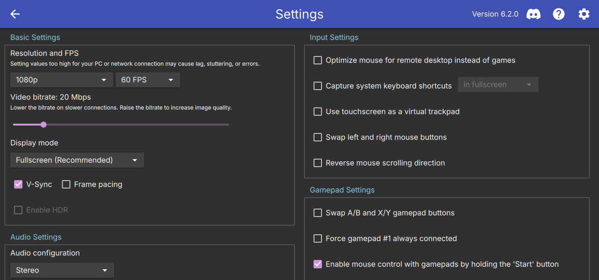

# Moonlight Armada

[](https://github.com/drluciano/moonlight-armada/actions/workflows/build-armada-flatpak.yml)
[](https://github.com/drluciano/moonlight-armada/actions/workflows/build-armada-appimage.yml)
[](LICENSE)

**Moonlight Armada lets you play games from your gaming PC on a Snapdragon handheld running [ArmadaOS](#about-armadaos), such as the AYN Odin.** Your PC runs the game, and the handheld shows the picture and sends your button presses back over Wi-Fi.

It's a version of [Moonlight](https://moonlight-stream.org), the popular open source game streaming app, with three additions:

- **An ultra low latency mode** that makes the handheld's video chip show each frame as soon as it's ready, instead of holding it back. It's the same idea as the Snapdragon low latency mode in [ClassicOldSong's Android version of Moonlight](https://github.com/ClassicOldSong/moonlight-android), rebuilt for Linux.
- **A redesigned look** made for small screens and controllers.
- **A one-tap install** for ArmadaOS that works from Steam's Game Mode, just like the regular Moonlight.



## Contents

**For everyone**
- [Install it](#install-it)
- [Add it to Game Mode](#add-it-to-game-mode)
- [Connect to your PC](#connect-to-your-pc)
- [Turn on ultra low latency mode](#turn-on-ultra-low-latency-mode)
- [Is it actually faster?](#is-it-actually-faster)
- [Screenshots](#screenshots)
- [Something's not working](#somethings-not-working)

**For developers**
- [How ultra low latency mode works](#how-ultra-low-latency-mode-works)
- [The Iris kernel patch](#the-iris-kernel-patch)
- [The new interface](#the-new-interface)
- [Building from source](#building-from-source)
- [Packaging](#packaging)
- [Roadmap](#roadmap)
- [What changed from moonlight-qt](#what-changed-from-moonlight-qt)

# For everyone

## Install it

Moonlight Armada comes as a **Flatpak**, the same kind of app package as the Moonlight you can get from Discover. No terminal or keyboard needed.

1. Switch your handheld to **Desktop Mode**.
2. Open the [Releases page](https://github.com/drluciano/moonlight-armada/releases) in the web browser and tap the file ending in **`.flatpak`** under the newest release to download it.
3. Open the downloaded file. **Discover** opens and offers to install Moonlight Armada. Tap **Install**.

Discover also downloads the KDE runtime that the app runs on, if you don't already have it from installing the regular Moonlight. Moonlight Armada installs alongside the regular Moonlight, so you can keep both.

To update, download and open a newer `.flatpak` the same way.

## Add it to Game Mode

1. Still in Desktop Mode, open **Steam**.
2. Choose **Games → Add a Non-Steam Game to My Library**.
3. Tick **Moonlight Armada** and choose **Add Selected Programs**.
4. Switch back to Game Mode. Moonlight Armada is in your library under **Non-Steam**.

## Connect to your PC

Moonlight Armada works with the same PC software as Moonlight. Install [Sunshine](https://github.com/LizardByte/Sunshine) (free) on your gaming PC, or use NVIDIA GeForce Experience if you already have it.

Open Moonlight Armada on the handheld while both are on the same network. Your PC shows up automatically. Select it, and type the PIN it shows into Sunshine on your PC. After that, pick a game and play.

## Turn on ultra low latency mode

1. In Moonlight Armada, open **Settings**. The **Latency** card is at the top.
2. Turn on **Ultra low latency decoding (experimental)**.
3. To see what it's doing, also turn on **Show performance stats while streaming**.
4. Start a stream.

Ultra low latency mode works best with the **H.264** video codec on today's ArmadaOS, and picks it for you when the codec setting is left on **Automatic** with HDR off. It also turns off **V-Sync** and **frame pacing**. V-Sync makes each frame wait for the screen's next refresh, which costs about 6 ms per frame in Game Mode, and frame pacing smooths out uneven frames by holding them back briefly. Without V-Sync you may occasionally see tearing. In Game Mode, also open the **…** quick menu, go to **Performance**, turn on **Allow Tearing**, and turn off the frame limit.

## Is it actually faster?

Here's what we've measured on an AYN Odin 3 in Game Mode, streaming H.264 at 1080p and 120 FPS. The performance stats show where the time goes for each frame:

- **Average decoding time:** how long each frame takes from arriving on the handheld to being turned into a picture.
- **Average rendering time:** how long it takes to put that picture on screen, including any wait for the screen to refresh.

| Game Mode, 120 FPS | Rendering time |
|---|---|
| V-Sync on | 6.5 ms |
| V-Sync off | 0.4 ms |

**V-Sync was the biggest source of delay in Game Mode.** With it on, every frame waited for the screen's next refresh, which added about 6 ms. Ultra low latency mode now turns V-Sync off for you.

**Ultra low latency mode doesn't change decoding time on today's ArmadaOS.** Switching it on and off made no difference in our tests. That's expected: the Odin's video driver has no low latency controls to turn on, and with H.264 the regular Moonlight already gets each frame back as soon as it's decoded. On this device the mode's real benefit is turning off V-Sync and frame pacing. The decoding settings are there for drivers that support them, and for HEVC and AV1 once the driver change described below lands.

**The slow decoding in Game Mode comes from the video driver, not Moonlight.** The Odin's driver runs the video chip just fast enough to keep up with the frame rate, so each frame takes about as long as the gap between frames: 8.6 ms inside the decoder at 120 FPS, and 16 ms at 60 FPS. In Desktop Mode the desktop's own activity keeps the clocks higher, which is why both the regular Moonlight and Moonlight Armada decode in under 1 ms there. An app can't change this from inside a Flatpak. It needs the [kernel patch](#the-iris-kernel-patch), which runs the video chip at full speed when an app asks for low latency. Desktop Mode isn't a practical way around it, because Steam's controller support there doesn't work well with the Odin's built-in gamepad.

Measure with a game running and moving, so the stats show close to your full frame rate. When the picture is still, your PC sends fewer frames (16 FPS on a still desktop, for example), the handheld's video chip slows down between them, and decoding times look worse than they are while you play. The **Average decoding time** line also splits into **waiting** (time a frame sat in line before reaching the video chip) and **in decoder** (time inside it), and a **Display** line shows the CPU clock speeds, which helps tell these cases apart.

Decoding time is only part of the delay you feel. Your network and the screen add their own time on top.

## Screenshots

These were taken with three example computers saved and no PC running, so they show as Offline.

| Computers | Settings |
|---|---|
|  |  |

### Before and after

The regular Moonlight 6.2.0 (left) next to Moonlight Armada (right), with the same saved computers and settings:

| Regular Moonlight | Moonlight Armada |
|---|---|
|  |  |
|  |  |

## Something's not working

- **Opening the `.flatpak` file doesn't open Discover.** Long-press or right-click the file, choose **Open With**, and pick **Discover**.
- **Discover says it can't find the runtime.** Discover needs the Flathub source, which ArmadaOS normally has. If you can install the regular Moonlight from Discover, it's set up.
- **It doesn't start from Game Mode.** Open the shortcut's **Properties → Compatibility** in Steam and make sure **Force the use of a specific Steam Play compatibility tool** is off. Moonlight Armada is a native Linux app, so Proton can't run it.
- **The performance stats say "Ultra low latency: partial".** You're streaming with HEVC or AV1. Set **Settings → Video codec** to **H.264**, or leave it on **Automatic** with HDR off.
- **The Video decoder line says "(software)".** The app couldn't use the handheld's video chip. Please [open an issue](https://github.com/drluciano/moonlight-armada/issues) with a photo of the performance stats.

### What the "Ultra low latency" line means

| Overlay text | Meaning |
|---|---|
| `active, Decode order output (qcom-venus)` | The decoder was switched to decode order output (and any vendor low latency controls listed). This is the full mode. |
| `active, H.264 fast path (iris_driver)` | The decoder has no decode order control (mainline Iris today), but the stream is H.264, which already outputs frames immediately. Still the full benefit. |
| `partial, iris_driver lacks decode order control` | HEVC or AV1 on a decoder without the control. Pacing and thread priority still apply, but the decoder may hold frames. Use H.264 or apply the [kernel patch](#the-iris-kernel-patch). |
| `active (generic)` | A non-V4L2 decoder (for example VA-API or software). Only the generic tuning applies. |

# For developers

## How ultra low latency mode works

### From Android to Linux

On Android, the Snapdragon low latency mode in moonlight-android sets Qualcomm's MediaCodec vendor keys. On Linux, the same hardware is driven through V4L2 stateful (memory-to-memory) decoders, which FFmpeg exposes as `h264_v4l2m2m` and `hevc_v4l2m2m`. Moonlight Armada maps each Android setting to its Linux counterpart:

| Android (MediaCodec) | Linux (V4L2) | What it does |
|---|---|---|
| `vendor.qti-ext-dec-picture-order.enable` | `V4L2_CID_MPEG_VIDEO_DEC_DISPLAY_DELAY_ENABLE` = 1 with `..._DISPLAY_DELAY` = 0 | Return frames in decode order as soon as they're decoded, instead of holding them for display order |
| `vendor.qti-ext-dec-low-latency.enable` | Any boolean driver control whose name contains "low latency" or "decode order" | Vendor kernels (such as Qualcomm's downstream `msm_vidc`) expose their low latency switches as private controls |
| `KEY_PRIORITY` / operating rate | Decoder thread at `SDL_THREAD_PRIORITY_TIME_CRITICAL` | Keep the decode thread from being preempted |
| (pacing off in the Android client) | Frame pacing disabled | Present each frame as soon as it's ready |

Moonlight never sends B-frames, so decode order is the same as display order and this tuning doesn't change the picture.

### Setting controls behind FFmpeg's back

FFmpeg doesn't expose V4L2 controls, and V4L2 controls belong to the file handle that opened the decoder. So `app/streaming/video/v4l2lowlatency.cpp`:

1. Records the open `/dev/video*` file descriptors (from `/proc/self/fd`) just before `avcodec_open2()`.
2. After the decoder opens, finds the new descriptor and confirms it's an M2M decoder with `VIDIOC_QUERYCAP`.
3. Sets the display delay controls, then walks every control on the device (`V4L2_CTRL_FLAG_NEXT_CTRL`) to enable matching vendor low latency toggles.

This works because FFmpeg's v4l2m2m wrapper only starts streaming when the first packet arrives, so controls set right after opening still take effect.

### Mainline Iris and the H.264 fast path

The Snapdragon 8 Gen 2, 8 Gen 3 and 8 Elite use Qualcomm's newer **Iris** video core. The mainline `iris` driver, which reports itself as `iris_driver`, doesn't yet expose the display delay controls, so the decode order switch isn't available on today's ArmadaOS kernel.

For H.264, Moonlight already rewrites each stream's SPS to set `max_dec_frame_buffering = 1`, so the decoder outputs every frame immediately anyway. When ultra low latency mode is on, HDR is off, and an Iris decoder without the control is found, Moonlight Armada therefore moves H.264 to the front of the codec list. HEVC needs the kernel patch to get the same behavior.

### What it does per decoder

| Decoder | H.264 | HEVC |
|---|---|---|
| Venus (`qcom-venus`, older Snapdragons) | Full mode | Full mode |
| Iris, mainline (`iris_driver`) | Full mode via the H.264 fast path (preferred automatically) | Partial |
| Iris with the [kernel patch](#the-iris-kernel-patch) | Full mode | Full mode |
| Downstream `msm_vidc` vendor kernels | Full mode, plus vendor low latency controls | Full mode, plus vendor low latency controls |
| Any other decoder | Generic tuning | Generic tuning |

## The Iris kernel patch

[`contrib/kernel/0001-media-qcom-iris-add-decode-order-output-for-gen2-dec.patch`](contrib/kernel/) adds the standard V4L2 display delay controls to the mainline Iris decoder on gen2 SoCs (SM8550, SM8650, SM8750 and others sharing the `inst_fw_cap_sm8550_dec` table). When display delay is enabled and set to 0, the driver sends `HFI_PROP_DECODE_ORDER_OUTPUT` (`0x0300015b`) to the firmware. That's the same property Qualcomm's downstream `msm_vidc` driver uses for this feature.

With the patch applied, Moonlight Armada sets the controls automatically and HEVC gets the full mode too. No app change is needed.

[`contrib/kernel/0002-media-qcom-iris-clock-low-latency-decoding-for-laten.patch`](contrib/kernel/) goes on top and helps every codec, H.264 included. Mainline Iris sets the decoder clock from the input frame rate it measured over the last second, and always votes DDR bandwidth for 30 FPS. That's just enough to keep up, so each frame takes about one frame interval to decode (8.6 ms at 120 FPS and 16 ms at 60 FPS on the Odin 3 in Game Mode). When a client asks for low latency through the display delay controls, the patch keeps the frame rate at the maximum, so the clock and bandwidth vote are set for the fastest decode. Other clients keep today's power behavior.

Both patches are compile-tested for arm64 against mainline with `W=1`, but not yet tested on hardware. They're meant for the ArmadaOS kernel maintainers, and each needs a `Signed-off-by` from whoever submits it upstream. See [`contrib/kernel/README.md`](contrib/kernel/README.md).

## The new interface

The interface keeps Moonlight's layout and gamepad navigation but restyles everything:

- **Theme.** `app/gui/Theme.qml` is a singleton design system: a deep blue-black palette (`#0D1017` to `#151A2B`), raised surfaces, a cyan accent (`#4FC3F7`), and shared corner radii, spacing, type sizes and animation timings. Qt's Material style is tinted to match.
- **Cards.** `Card.qml` and `NavigableItemDelegate.qml` give computers and apps rounded cards with a hover and focus lift and a clear accent focus ring for gamepad and keyboard navigation.
- **Status chips.** `StatusChip.qml` shows each computer's state at a glance: Checking…, Online, Not paired or Offline. Running apps get a "Running" chip.
- **Toolbar.** The toolbar is now a flat surface with a hairline divider, the logo, a left-aligned page title, a "Moonlight Armada" caption, and a muted version label.
- **Settings.** Settings are grouped into rounded `SettingsCard` panels with accent titles, and collapse to a single column under 900 px wide. A new **Latency** card at the top holds the ultra low latency switch.
- **Dialogs.** Modal dialogs dim the background with a darker scrim.

## Building from source

### Requirements

Moonlight Armada builds the same way as moonlight-qt. On Ubuntu 24.04 (arm64 or x86_64), install:

```sh
sudo apt install build-essential pkg-config \
  qt6-base-dev qt6-declarative-dev qt6-svg-dev qt6-wayland qt6-qpa-plugins qt6-image-formats-plugins \
  qml6-module-qtquick qml6-module-qtquick-controls qml6-module-qtquick-templates qml6-module-qtquick-layouts \
  qml6-module-qtquick-window qml6-module-qtquick-dialogs qml6-module-qtqml-workerscript \
  libsdl2-dev libsdl2-ttf-dev libavcodec-dev libavformat-dev libavutil-dev libswscale-dev \
  libva-dev libvdpau-dev libopus-dev libssl-dev libdrm-dev libegl-dev libgbm-dev libwayland-dev libx11-dev
```

On Arch or ArmadaOS, install the equivalents: `qt6-base qt6-declarative qt6-svg qt6-wayland sdl2 sdl2_ttf ffmpeg libva libvdpau opus openssl libdrm`.

### Build

```sh
git clone --recursive https://github.com/drluciano/moonlight-armada.git
cd moonlight-armada
mkdir build && cd build
qmake6 ../moonlight-qt.pro CONFIG+=release
make -j$(nproc)
```

The binary is `build/app/moonlight`. Pass `--ultra-low-latency` or `--no-ultra-low-latency` to `moonlight stream` to override the setting from the command line.

## Packaging

### Flatpak (the recommended install)

[`packaging/flatpak/io.github.drluciano.MoonlightArmada.json`](packaging/flatpak/io.github.drluciano.MoonlightArmada.json) is based on [Flathub's Moonlight manifest](https://github.com/flathub/com.moonlight_stream.Moonlight), so the app runs in the same environment that's known to work in Game Mode. The differences are:

- its own app ID, `io.github.drluciano.MoonlightArmada`, so it installs next to stock Moonlight and keeps separate settings,
- this repository as the app source,
- an explicit `CMAKE_INSTALL_LIBDIR=lib` on the CMake modules, which the aarch64 build needs to find SDL,
- no x86_64-only gamescope WSI layer.

The manifest builds its own FFmpeg (cgutman's Moonlight branch with `h264_v4l2m2m`, `hevc_v4l2m2m` and V4L2 request decoders), SDL3 with sdl2-compat, SDL2_ttf, dav1d and libplacebo on the KDE 6 runtime. It has `--device=all`, so the app can open `/dev/video*` for the hardware decoder.

To build it on an arm64 machine with flatpak-builder:

```sh
flatpak-builder --user --install-deps-from=flathub --repo=repo --force-clean build-dir \
  packaging/flatpak/io.github.drluciano.MoonlightArmada.json
flatpak build-bundle repo Moonlight-Armada-aarch64.flatpak io.github.drluciano.MoonlightArmada \
  --runtime-repo=https://dl.flathub.org/repo/flathub.flatpakrepo
```

The `--runtime-repo` option is what lets Discover fetch the KDE runtime when someone opens the bundle.

### AppImage

The AppImage is a single file that runs in Desktop Mode without installing. It doesn't launch reliably from Game Mode, so the Flatpak is the recommended install. To package it on an arm64 machine with [appimagetool](https://github.com/AppImage/appimagetool) on your `PATH`:

```sh
scripts/build-appimage-armada.sh build out/Moonlight-Armada-aarch64.AppImage
```

The script also works for cross-builds from x86_64 using Ubuntu's multiarch arm64 packages. In that case, set `CROSS=aarch64-linux-gnu-`.

Opening the AppImage copies the app to `~/.local/share/moonlight-armada`, adds a menu entry, and adds a Steam shortcut (closing and reopening Steam while it edits `shortcuts.vdf`, and keeping a `shortcuts.vdf.armada-backup`). Every run is logged to `~/.cache/moonlight-armada/last-run.log`.

#### How the AppImage is packaged

ArmadaOS is Arch-based and can be lean, so the AppImage bundles everything except a core set of libraries that every Arch desktop or Steam install provides: glibc and the C++ runtime, Mesa/GL, X11/xcb, Wayland, xkbcommon, glib, harfbuzz, fontconfig/freetype, ALSA, dbus and systemd/udev. These choices came out of on-device testing:

- **OpenSSL is bundled as a matched pair.** Qt loads libssl at runtime, so it never shows up as a link dependency. Pairing the system's libssl with an older bundled libcrypto broke pairing-key generation, so both ship together.
- **libproxy is replaced by a stub.** The real library pulls in curl, gnutls and p11-kit, which load system plugins at startup and can crash on a mismatched system. The stub ([`app/deploy/linux/armada/libproxy-stub.c`](app/deploy/linux/armada/libproxy-stub.c)) always reports a direct connection.
- **libva prefers the system copy.** As in upstream's AppImage, VA-API drivers only load with a matching libva, so the bundled libva is only a fallback for systems without one.
- **Wayland stays on.** Upstream's AppImage disables Wayland because it bundles libwayland-client. This one uses the system's, which matters for Gamescope and KDE.
- **Every run is logged.** The AppRun writes each run to `~/.cache/moonlight-armada/last-run.log`. If a library is missing, the log lists every missing library in one pass.

### Continuous integration and releases

Both builds run on GitHub's native `ubuntu-24.04-arm` runners:

- [`build-armada-flatpak.yml`](.github/workflows/build-armada-flatpak.yml) builds the Flatpak bundle, installs it, and checks that it starts.
- [`build-armada-appimage.yml`](.github/workflows/build-armada-appimage.yml) builds the AppImage and checks that it starts without missing libraries.

Pull requests and pushes to `main` upload both as build artifacts. Tags starting with `v` (for example `v0.1.0`) publish a GitHub Release with both files; tags with a suffix, such as `v0.1.0-test1`, are published as pre-releases. A test pre-release of the Flatpak alone can also be published by running the Flatpak workflow by hand with a `test_release` tag.

## Roadmap

- **Close the Game Mode decode gap.** Get both kernel patches into the ArmadaOS kernel and measure decoding in Game Mode again.
- **Zero-copy frames.** FFmpeg's v4l2m2m decoder returns frames in system memory (NV12), so each frame is copied before display. DRM-PRIME output for V4L2 would remove that copy.
- **Upstream the Iris patch** through the ArmadaOS kernel and then mainline Linux, so HEVC gets the full mode everywhere.
- **Publish on Flathub** so updates arrive through Discover automatically.

## What changed from moonlight-qt

| Area | Files |
|---|---|
| Ultra low latency decoding | `app/streaming/video/v4l2lowlatency.{h,cpp}` (new), `ffmpeg.{h,cpp}`, `decoder.h`, `app/streaming/session.{h,cpp}` |
| Setting and CLI flag | `app/settings/streamingpreferences.{h,cpp}`, `app/cli/commandlineparser.cpp`, `app/gui/SettingsView.qml` |
| Interface | `app/gui/Theme.qml`, `Card.qml`, `StatusChip.qml`, `SettingsCard.qml` (new), `main.qml`, `PcView.qml`, `AppView.qml`, `NavigableItemDelegate.qml`, `app/main.cpp` |
| Kernel patch | `contrib/kernel/` (new) |
| Packaging and CI | `packaging/flatpak/` (new), `scripts/build-appimage-armada.sh`, `app/deploy/linux/armada/` (new), `.github/workflows/build-armada-flatpak.yml` and `build-armada-appimage.yml` (replace upstream's Windows, macOS, Steam Link and x86_64 workflows) |

Everything else is upstream moonlight-qt. For upstream's features, supported platforms and build instructions for other systems, see the [moonlight-qt README](https://github.com/moonlight-stream/moonlight-qt#readme).

## About ArmadaOS

ArmadaOS is an Arch-based (CachyOS-derived), SteamOS-like Linux distribution for ARM handhelds such as the AYN Odin and Thor series. It boots into Steam and Gamescope on Snapdragon hardware, with a separate Desktop Mode.

## Credits and license

- [moonlight-stream/moonlight-qt](https://github.com/moonlight-stream/moonlight-qt) by the Moonlight Game Streaming Project, the base of this project.
- [ClassicOldSong/moonlight-android](https://github.com/ClassicOldSong/moonlight-android), whose Snapdragon low latency mode inspired the Linux implementation.
- Qualcomm's `msm_vidc` video driver (CodeLinaro), which documents the decode order output property used by the kernel patch.

Moonlight Armada is licensed under the [GNU General Public License v3.0](LICENSE), the same as moonlight-qt.
